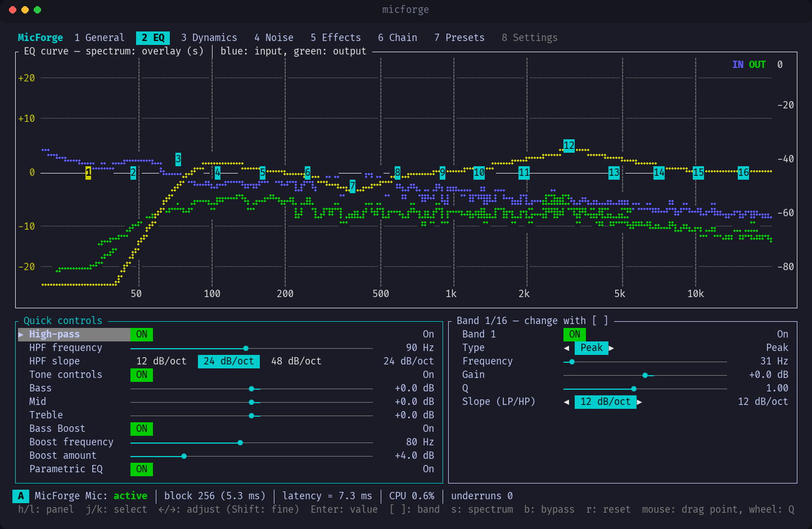
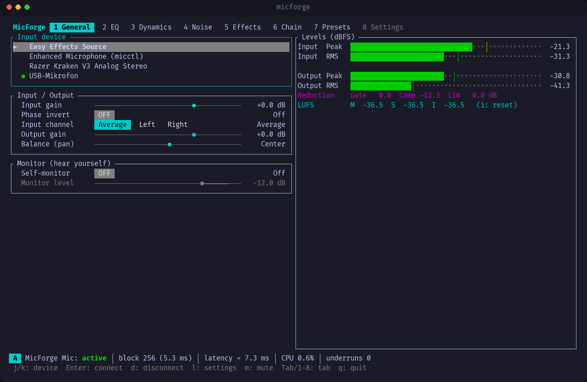
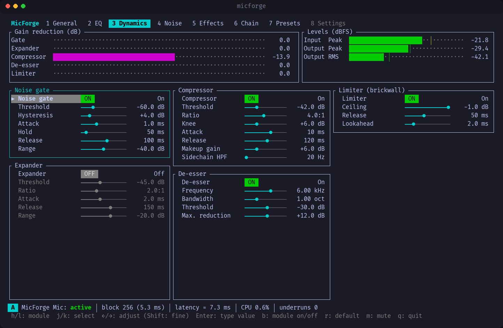
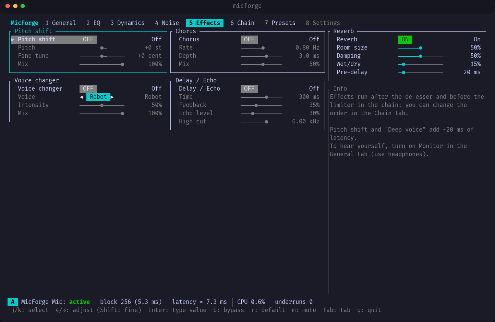
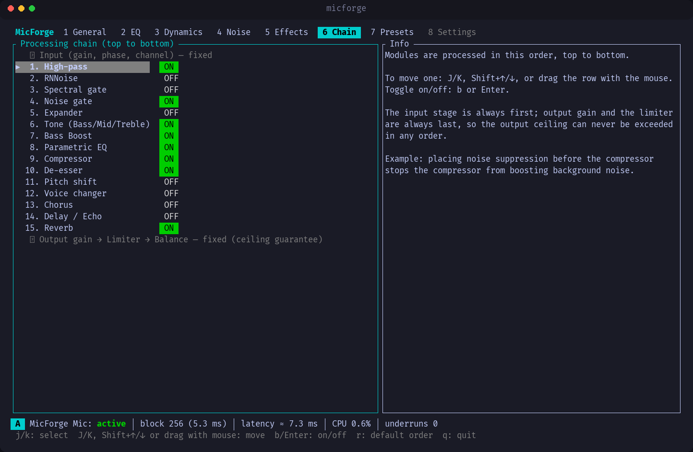
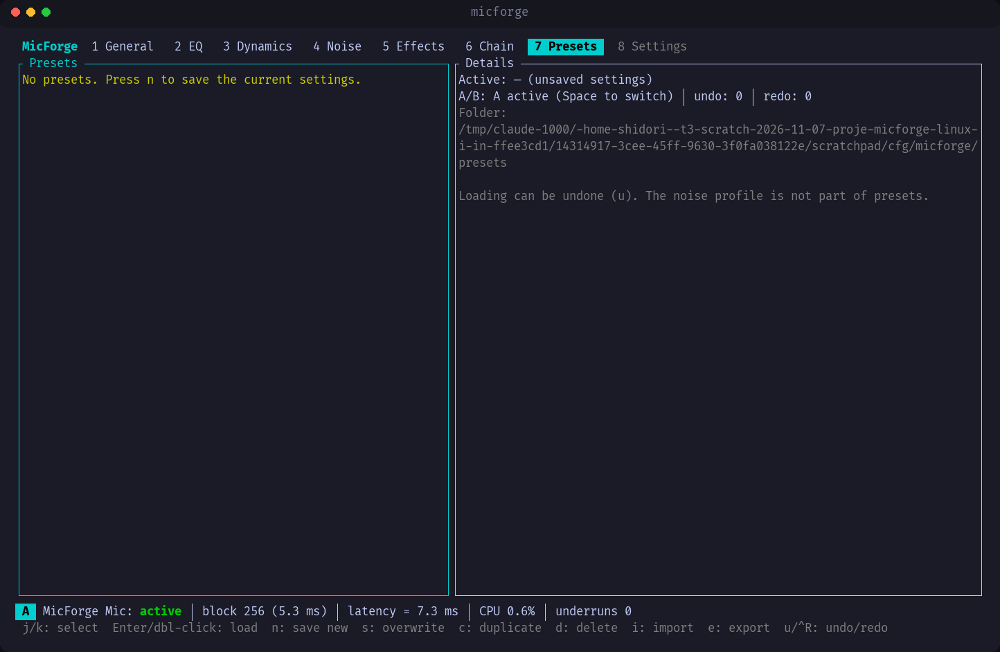
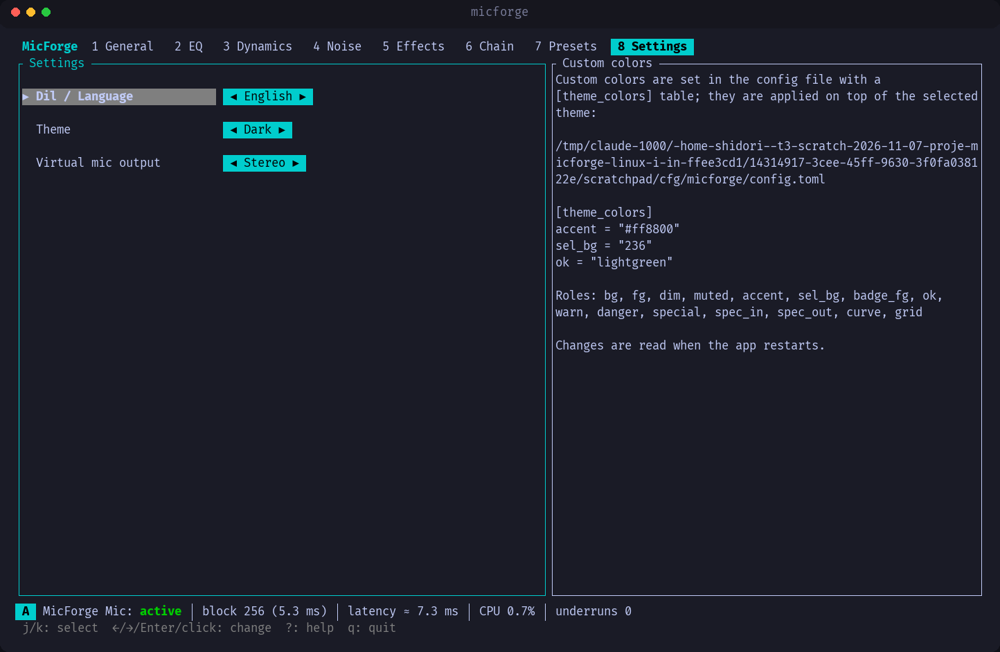
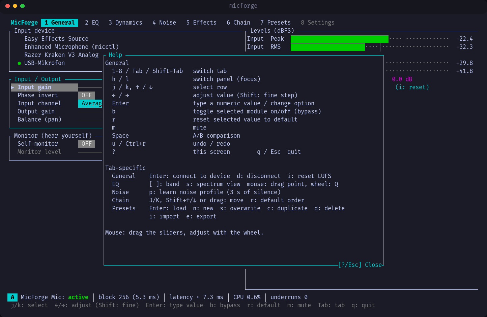

<div align="center">

# 🎙️ MicForge

**A real-time microphone processing studio for the Linux terminal**

Pick your microphone, run it through EQ, dynamics, noise suppression and effects,<br>
then use the result in Discord, OBS and any other app as a virtual mic called **"MicForge Mic"**.

[](LICENSE)
[](https://www.rust-lang.org)
[](https://pipewire.org)
[](#install)
[](https://ratatui.rs)

🇹🇷 [Türkçe](README.md) · [Features](#features) · [Screenshots](#screenshots) · [Install](#install) · [Usage](#usage) · [Shortcuts](#shortcuts) · [Troubleshooting](#troubleshooting)



</div>

---

## ✨ Why MicForge?

- **One window, the whole chain.** Noise suppression, gate, compressor, 16-band EQ, de-esser, limiter and effects in a single terminal UI.
- **Low latency.** About **5–7 ms** base latency (256 samples at 48 kHz). With every module enabled it still uses only **1.2 %** of the real-time budget.
- **Real-time safe.** No allocations, locks, file I/O or logging on the audio thread. Parameters travel through lock-free atomics and are smoothed, so adjusting them never crackles.
- **No daemon.** Processing runs only while the app is open. Closing it removes the virtual mic, including after Ctrl+C, SIGTERM or a crash.
- **Keyboard + mouse.** Vim-style navigation, draggable sliders and draggable band points on the EQ graph.

<a id="features"></a>

## 🎛️ Features

| Tab | What's inside |
| --- | --- |
| **General** | Input device selection (hot-plug aware), input/output gain, phase invert, channel select, balance · peak/RMS meters · **LUFS** (momentary / short-term / integrated) · **Monitor** (hear yourself) |
| **EQ** | **16-band parametric EQ** (peak, shelf, low/high-pass, notch, band-pass; RBJ biquads) · live input/output **spectrum** with the EQ curve on top · Bass / Mid / Treble · Bass Boost · High-pass · 12/24/48 dB/oct slopes |
| **Dynamics** | Noise gate (with hysteresis) · expander · compressor (soft knee, sidechain HPF) · de-esser · **brickwall limiter** (lookahead) · gain-reduction meters |
| **Noise** | **RNNoise** (AI, 0–100 %) · spectral noise gate with **"learn profile"** (3 s of silence) |
| **Effects** | Pitch shift (±12 semitones + cents) · voice changer (**robot / deep / radio**) · chorus · delay/echo · reverb |
| **Chain** | Reorder all 15 modules with **drag & drop**, toggle each one on or off |
| **Presets** | 6 built-ins: Yayın/Podcast (broadcast), Discord, Oyun (gaming), Derin Radyo Sesi (deep radio voice), Toplantı (meeting), Ham (raw) · save / load / duplicate / delete / import / export |
| **Settings** | Turkish / English · dark / light theme + custom colors · virtual mic **mono / stereo** |

Also included: **undo / redo**, **A/B comparison**, a clipping warning, latency / CPU / underrun readouts in the status bar, and it remembers your last device and preset.

> [!WARNING]
> **Monitor** sends your processed voice to your output device. Use **headphones**, not speakers. If acoustic feedback (howling) is detected, the monitor turns itself off.

<a id="screenshots"></a>

## 📸 Screenshots

<table>
  <tr>
    <td width="50%"><br><sub><b>General</b>: device, gain, meters, LUFS, monitor</sub></td>
    <td width="50%"><br><sub><b>Dynamics</b>: gate, compressor, de-esser, limiter</sub></td>
  </tr>
  <tr>
    <td><br><sub><b>Effects</b>: pitch, voice changer, chorus, delay, reverb</sub></td>
    <td><br><sub><b>Chain</b>: drag & drop processing order</sub></td>
  </tr>
  <tr>
    <td><br><sub><b>Presets</b>: built-ins and your own</sub></td>
    <td><br><sub><b>Settings</b>: language, theme, mono/stereo</sub></td>
  </tr>
</table>

<details>
<summary><b>Help screen (<code>?</code>)</b></summary>
<br>

</details>

## 🔊 Signal chain

```mermaid
flowchart LR
    MIC([🎤 Physical mic]) --> IN[Input gain<br>phase · channel]
    IN --> CHAIN
    subgraph CHAIN [15 reorderable modules]
        direction LR
        A[High-pass] --> B[RNNoise] --> C[Spectral gate] --> D[Gate / Expander]
        D --> E[Tone / Bass Boost / EQ] --> F[Compressor / De-esser]
        F --> G[Pitch / Voice changer] --> H[Chorus / Delay / Reverb]
    end
    CHAIN --> OUT[Output gain] --> LIM[Brickwall limiter] --> PAN[Balance]
    PAN --> VM([🎙️ MicForge Mic])
    PAN -.-> MON([🎧 Monitor])
```



The input stage always comes first, and the output gain and limiter always come last. Whatever order you give the modules, the output ceiling is never exceeded.

<a id="install"></a>

## 📦 Install

Runs on any Linux distribution with PipeWire **1.0 or newer**:

| Distribution | Status |
| --- | --- |
| Arch, CachyOS, Manjaro, EndeavourOS | ✅ |
| Ubuntu 24.04+, Debian 13+ | ✅ |
| Fedora 40+ | ✅ |
| Debian 12, Ubuntu 22.04 | ❌ PipeWire too old |

Prebuilt packages are uploaded to [Releases](https://github.com/Shidori5417/micforge/releases) automatically for every version (x86_64).

### Ubuntu / Debian (.deb)

```sh
wget https://github.com/Shidori5417/micforge/releases/latest/download/micforge_0.1.0-1_amd64.deb
sudo apt install ./micforge_0.1.0-1_amd64.deb
```

### Fedora (.rpm)

```sh
sudo dnf install https://github.com/Shidori5417/micforge/releases/latest/download/micforge-0.1.0-1.x86_64.rpm
```

### Arch Linux and derivatives

```sh
git clone https://github.com/Shidori5417/micforge.git
cd micforge
makepkg -si
```

### Other distributions (.tar.gz)

```sh
wget https://github.com/Shidori5417/micforge/releases/latest/download/micforge-0.1.0-x86_64-linux.tar.gz
tar xzf micforge-0.1.0-x86_64-linux.tar.gz
install -Dm755 micforge-0.1.0-x86_64-linux/micforge ~/.local/bin/micforge
```

### Build from source

Requires Rust **≥ 1.85**, `clang`, `pkgconf` and the PipeWire development headers (Arch: `libpipewire`, Ubuntu: `libpipewire-0.3-dev libclang-dev`, Fedora: `pipewire-devel clang`).

```sh
cargo build --release
install -Dm755 target/release/micforge ~/.local/bin/micforge
```

<a id="usage"></a>

## 🚀 Usage

```sh
micforge
```

1. On the **General** tab, pick your microphone: move with `j` / `k`, connect with `Enter`.
2. Load a **preset** (tab `7`) or tune everything yourself.
3. In your app, choose **MicForge Mic** as the input device.

<details>
<summary><b>Discord</b></summary>

1. **User Settings → Voice & Video**.
2. **Input Device** → **MicForge Mic**.
3. Turn off Discord's own **noise suppression**, **echo cancellation** and **automatic gain control** so your voice isn't processed twice.
</details>

<details>
<summary><b>OBS Studio</b></summary>

- **Sources → + → Audio Input Capture (PipeWire / PulseAudio) → Device: MicForge Mic**
- or **Settings → Audio → Mic/Auxiliary Audio → MicForge Mic**
</details>

<details>
<summary><b>Other apps</b></summary>

In `pavucontrol`, open the **Recording** tab and set the app's input to **MicForge Mic**, or use your desktop's sound settings.
</details>

<a id="shortcuts"></a>

## ⌨️ Keyboard shortcuts

| Key | Action | | Key | Action |
| --- | --- | --- | --- | --- |
| `1`–`8` / `Tab` | Switch tab | | `b` | Toggle module (bypass) |
| `h` / `l` | Switch panel | | `r` | Reset to default |
| `j` / `k` | Select row | | `m` | Mute |
| `←` / `→` | Adjust (`Shift`: fine) | | `Space` | A/B comparison |
| `Enter` | Type a value | | `u` / `Ctrl+r` | Undo / redo |
| `?` | Help | | `q` / `Esc` | Quit |

| Tab | Extra keys |
| --- | --- |
| General | `Enter` connect · `d` disconnect · `i` reset LUFS |
| EQ | `[` `]` band · `s` spectrum view · mouse: drag point, wheel: Q |
| Noise | `p` learn noise profile |
| Chain | `J` / `K` or drag: move · `r` default order |
| Presets | `Enter` load · `n` new · `s` overwrite · `c` duplicate · `d` delete · `i` import · `e` export |

## ⚙️ Configuration

| File | Contents |
| --- | --- |
| `~/.config/micforge/config.toml` | Last device, parameters, module order, language, theme, channel count |
| `~/.config/micforge/presets/*.toml` | Presets (shareable TOML files) |

A corrupt config never crashes the app. The file is backed up as `config.toml.bak-<time>`, defaults are loaded, and you get a warning.

**Custom colors** are applied on top of the selected theme:

```toml
theme = "dark"            # "dark" or "light"

[theme_colors]
accent = "#ff8800"        # "#rrggbb", "red", "lightblue", "236" …
ok     = "lightgreen"
```

Roles: `bg` `fg` `dim` `muted` `accent` `sel_bg` `badge_fg` `ok` `warn` `danger` `special` `spec_in` `spec_out` `curve` `grid`

## ⏱️ Latency & performance

| Configuration | Added latency |
| --- | --- |
| Base (256 samples @ 48 kHz) | ~5–7 ms |
| + RNNoise | +~20 ms |
| + Spectral gate | +~10.7 ms |
| + Pitch / deep voice | +~20 ms |
| + Limiter lookahead | +0.5–10 ms (adjustable) |

The status bar shows the total latency live. Bypassed modules use no CPU.

| Benchmark (criterion, 256 samples) | Time | Budget |
| --- | --- | --- |
| Defaults | 2 µs | 0.04 % |
| Typical voice chain | 17 µs | 0.3 % |
| Noise suppression | 33 µs | 0.6 % |
| Effects | 26 µs | 0.5 % |
| **Everything on** | **66 µs** | **1.2 %** |

<a id="troubleshooting"></a>

## 🩺 Troubleshooting

<details>
<summary><b>PipeWire error / won't start</b></summary>

```sh
systemctl --user status pipewire wireplumber
systemctl --user restart pipewire wireplumber
```
</details>

<details>
<summary><b>"MicForge is already running"</b></summary>

Only one instance can run at a time (lock file: `$XDG_RUNTIME_DIR/micforge.lock`). Find the running one with `pgrep -a micforge` and close it.
</details>

<details>
<summary><b>"MicForge Mic" doesn't show up in an app</b></summary>

The virtual mic only exists while MicForge is running. Start MicForge first, then refresh the app's device list. If you switched between mono and stereo, you may need to select the mic in the app again.
</details>

<details>
<summary><b>Howling / echo with the monitor on</b></summary>

Use headphones. When feedback is detected the monitor switches off; turn it back on from the General tab.
</details>

<details>
<summary><b>Reset all settings</b></summary>

Delete `~/.config/micforge/config.toml`. Presets live in a separate folder and are kept.
</details>

## 🛠️ Development

```sh
cargo test --workspace                                  # unit tests
cargo clippy --workspace --all-targets -- -D warnings   # lint
cargo bench -p micforge-dsp --bench chain               # DSP benchmark
```

```text
crates/
├── micforge-dsp     pure-Rust DSP modules (no PipeWire dependency, fully testable)
├── micforge-audio   PipeWire engine: capture, virtual mic, monitor
└── micforge-tui     ratatui UI and the `micforge` binary
```

Feature flags: `pitch` (on by default). DeepFilterNet support is planned.

## 📄 License

[GPL-3.0-or-later](LICENSE) © Mehmet Karaca
