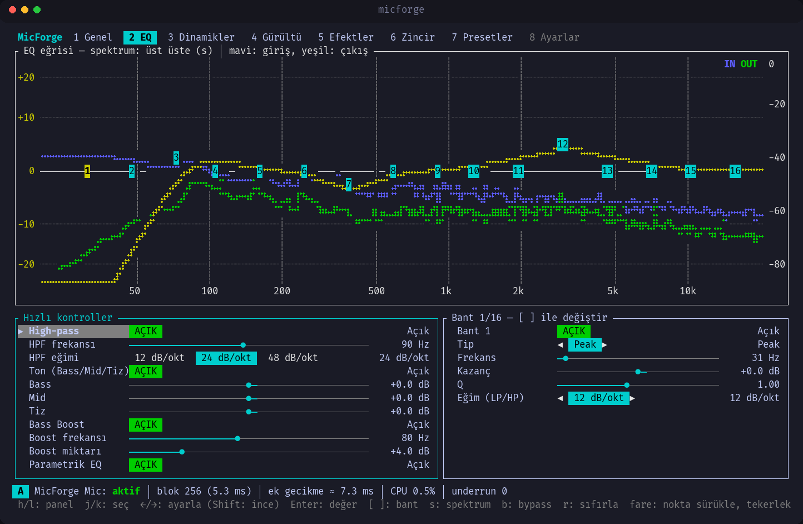
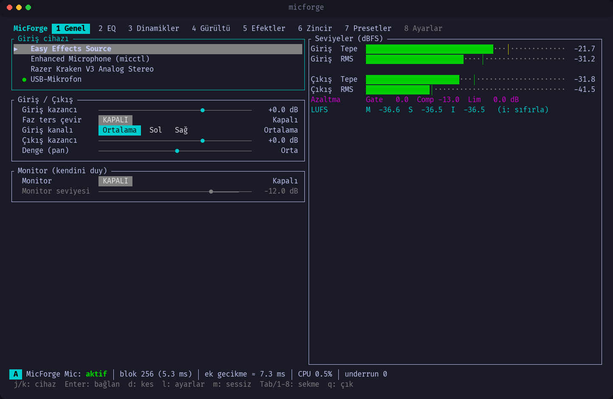
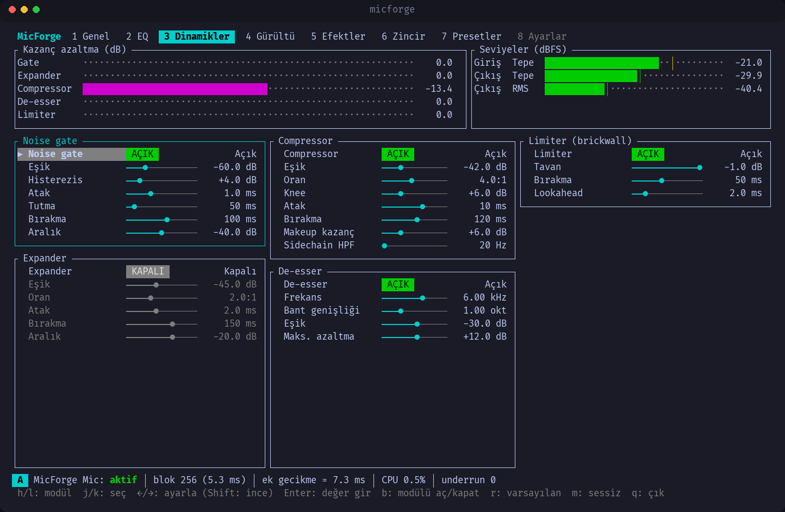
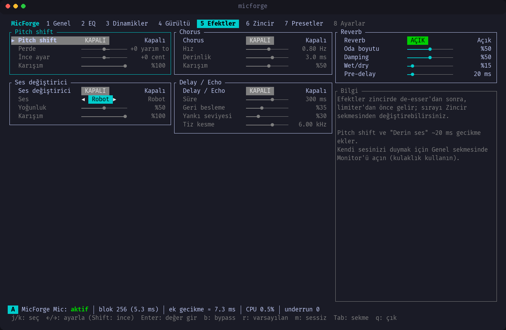
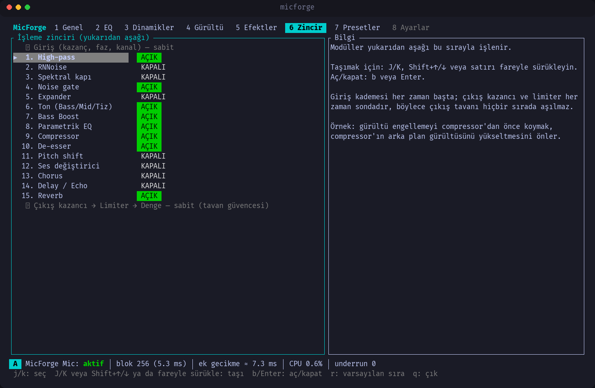
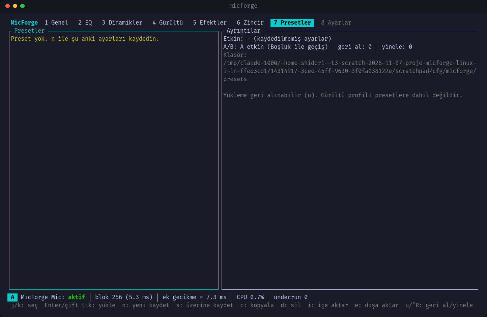
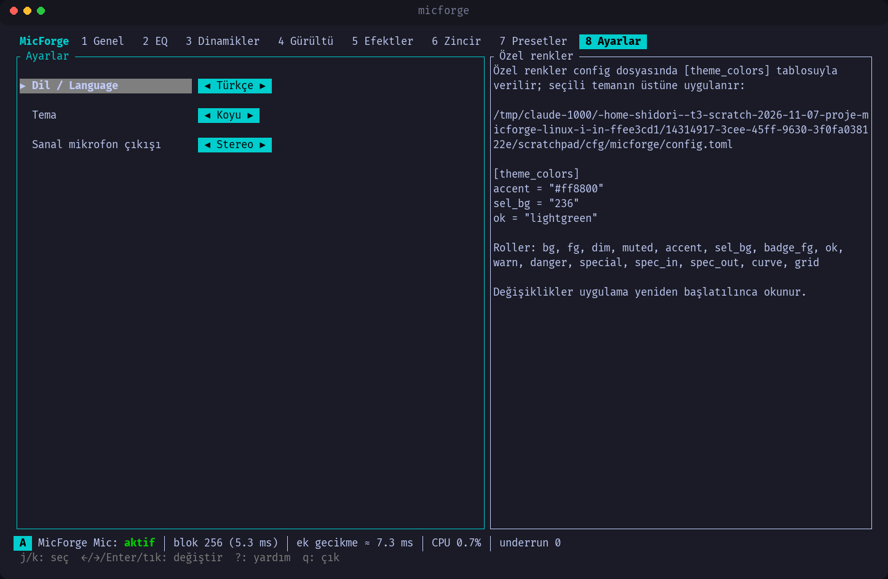
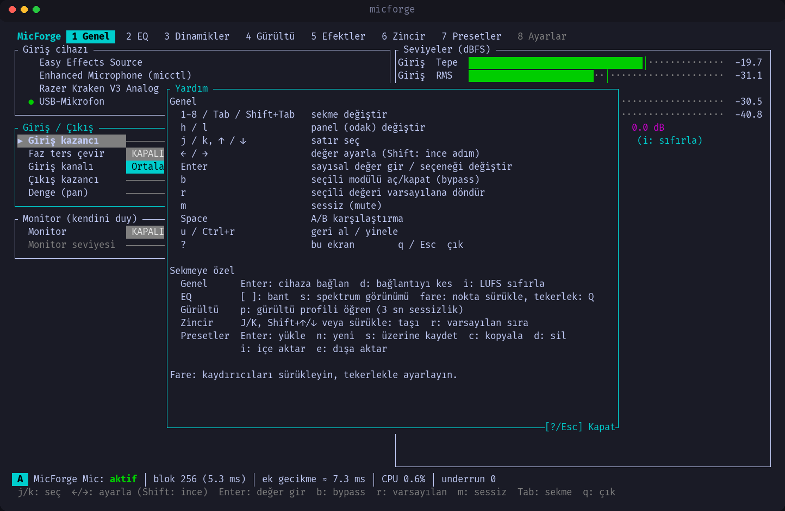

<div align="center">

# 🎙️ MicForge

**Linux için terminalde çalışan, gerçek zamanlı mikrofon işleme stüdyosu**

Mikrofonunu seç, sesini EQ, dinamik işleme, gürültü bastırma ve efektlerden geçir;<br>
sonucu Discord, OBS ve diğer uygulamalarda **„MicForge Mic”** adlı sanal mikrofon olarak kullan.

[](LICENSE)
[](https://www.rust-lang.org)
[](https://pipewire.org)
[](#kurulum)
[](https://ratatui.rs)

🇬🇧 [English](README.en.md) · [Özellikler](#ozellikler) · [Ekranlar](#ekranlar) · [Kurulum](#kurulum) · [Kullanım](#kullanim) · [Kısayollar](#kisayollar) · [Sorun giderme](#sorun-giderme)



</div>

---

## ✨ Neden MicForge?

- **Tek pencere, tüm zincir.** Gürültü bastırma, gate, compressor, 16 bantlı EQ, de-esser, limiter ve efektler tek bir terminal arayüzünde.
- **Düşük gecikme.** Temel gecikme yaklaşık **5–7 ms** (256 örnek / 48 kHz). Tüm modüller açıkken bile işlemci kullanımı gerçek zaman bütçesinin **%1,2**'si kadar.
- **Gerçek zamanlı güvenli.** Ses thread'inde bellek ayırma, kilit, dosya işlemi ve log yok. Parametreler kilitsiz atomiklerle aktarılıyor ve yumuşatılıyor, böylece ayar değiştirirken cızırtı duyulmuyor.
- **Daemon yok.** İşleme yalnızca uygulama açıkken yapılır. Kapattığında sanal mikrofon da kaybolur; Ctrl+C, SIGTERM ve çökme durumunda bile temizlenir.
- **Klavye + fare.** Vim tarzı gezinme, sürüklenebilir kaydırıcılar, EQ grafiğinde sürüklenebilir bant noktaları.

<a id="ozellikler"></a>

## 🎛️ Özellikler

| Sekme | Neler var |
| --- | --- |
| **Genel** | Giriş cihazı seçimi (tak-çıkar destekli), giriş/çıkış kazancı, faz çevirme, kanal seçimi, denge · tepe/RMS metreleri · **LUFS** (anlık / kısa süreli / entegre) · **Monitor** (kendini duy) |
| **EQ** | **16 bantlı parametrik EQ** (peak, shelf, low/high-pass, notch, band-pass; RBJ biquad) · canlı **spektrum** (giriş/çıkış) ve EQ eğrisi · Bass / Mid / Tiz · Bass Boost · High-pass · 12/24/48 dB/okt eğim |
| **Dinamikler** | Noise gate (histerezisli) · expander · compressor (soft knee, sidechain HPF) · de-esser · **brickwall limiter** (lookahead) · kazanç azaltma göstergeleri |
| **Gürültü** | **RNNoise** (yapay zekâ, %0–100) · spektral gürültü kapısı + **„profil öğren”** (3 sn sessizlik) |
| **Efektler** | Pitch shift (±12 yarım ton + cent) · ses değiştirici (**robot / derin ses / telsiz**) · chorus · delay/echo · reverb |
| **Zincir** | 15 modülün sırasını **sürükle-bırak** ile değiştir, her birini ayrı aç/kapat |
| **Presetler** | 6 hazır preset (Yayın/Podcast, Discord, Oyun, Derin Radyo Sesi, Toplantı, Ham) · kaydet / yükle / kopyala / sil / içe-dışa aktar |
| **Ayarlar** | Türkçe / İngilizce · koyu / açık tema + özel renkler · sanal mikrofon **mono / stereo** |

Ayrıca: **geri al / yinele**, **A/B karşılaştırma**, clipping uyarısı, durum çubuğunda gecikme / CPU / underrun göstergesi, son cihaz ve presetin hatırlanması.

> [!WARNING]
> **Monitor** işlenmiş sesini çıkış cihazına verir. Hoparlör yerine **kulaklık** kullan. Akustik geri besleme (ıslık) algılanırsa monitor kendiliğinden kapanır.

<a id="ekranlar"></a>

## 📸 Ekranlar

<table>
  <tr>
    <td width="50%"><br><sub><b>Genel</b>: cihaz, kazanç, metreler, LUFS, monitor</sub></td>
    <td width="50%"><br><sub><b>Dinamikler</b>: gate, compressor, de-esser, limiter</sub></td>
  </tr>
  <tr>
    <td><br><sub><b>Efektler</b>: pitch, ses değiştirici, chorus, delay, reverb</sub></td>
    <td><br><sub><b>Zincir</b>: sürükle-bırak ile işlem sırası</sub></td>
  </tr>
  <tr>
    <td><br><sub><b>Presetler</b>: hazır ve kendi ayarların</sub></td>
    <td><br><sub><b>Ayarlar</b>: dil, tema, mono/stereo</sub></td>
  </tr>
</table>

<details>
<summary><b>Yardım ekranı (<code>?</code>)</b></summary>
<br>

</details>

## 🔊 Ses zinciri

```mermaid
flowchart LR
    MIC([🎤 Fiziksel mikrofon]) --> IN[Giriş kazancı<br>faz · kanal]
    IN --> CHAIN
    subgraph CHAIN [Sırası değiştirilebilir 15 modül]
        direction LR
        A[High-pass] --> B[RNNoise] --> C[Spektral kapı] --> D[Gate / Expander]
        D --> E[Ton / Bass Boost / EQ] --> F[Compressor / De-esser]
        F --> G[Pitch / Ses değiştirici] --> H[Chorus / Delay / Reverb]
    end
    CHAIN --> OUT[Çıkış kazancı] --> LIM[Brickwall limiter] --> PAN[Denge]
    PAN --> VM([🎙️ MicForge Mic])
    PAN -.-> MON([🎧 Monitor])
```



Giriş kademesi her zaman başta, çıkış kazancı ve limiter her zaman sonda olduğu için modül sırası ne olursa olsun **limiter açıkken** çıkış tavanı aşılmaz. Limiter kapalıysa (ör. `Ham` preseti) bu garanti geçerli değildir.

<a id="kurulum"></a>

## 📦 Kurulum

PipeWire **1.0 veya üstü** olan her Linux dağıtımında çalışır:

| Dağıtım | Durum |
| --- | --- |
| Arch, CachyOS, Manjaro, EndeavourOS | ✅ |
| Ubuntu 24.04+, Debian 13+ | ✅ |
| Fedora 40+ | ✅ |
| Debian 12, Ubuntu 22.04 | ❌ PipeWire çok eski |

Hazır paketler her sürümde [Releases](https://github.com/Shidori5417/micforge/releases) sayfasına otomatik yüklenir (x86_64).

### Ubuntu / Debian (.deb)

```sh
wget https://github.com/Shidori5417/micforge/releases/latest/download/micforge_amd64.deb
sudo apt install ./micforge_amd64.deb
```

### Fedora (.rpm)

```sh
sudo dnf install https://github.com/Shidori5417/micforge/releases/latest/download/micforge.x86_64.rpm
```

### Arch Linux ve türevleri

```sh
git clone https://github.com/Shidori5417/micforge.git
cd micforge
makepkg -si
```

### Diğer dağıtımlar (.tar.gz)

```sh
wget https://github.com/Shidori5417/micforge/releases/latest/download/micforge-x86_64-linux.tar.gz
tar xzf micforge-x86_64-linux.tar.gz
install -Dm755 micforge-x86_64-linux/micforge ~/.local/bin/micforge
```

### Kaynaktan derleme

Rust **≥ 1.89**, `clang`, `pkgconf` ve PipeWire geliştirme başlıkları gerekir (Arch: `libpipewire`, Ubuntu: `libpipewire-0.3-dev libclang-dev`, Fedora: `pipewire-devel clang`).

```sh
cargo build --release
install -Dm755 target/release/micforge ~/.local/bin/micforge
```

<a id="kullanim"></a>

## 🚀 Kullanım

```sh
micforge
```

1. **Genel** sekmesinde mikrofonunu seç: `j` / `k` ile gez, `Enter` ile bağlan.
2. Bir **preset** yükle (sekme `7`) ya da ayarları kendin yap.
3. Uygulamanda giriş cihazı olarak **MicForge Mic**'i seç.

<details>
<summary><b>Discord'da seçme</b></summary>

1. **Kullanıcı Ayarları → Ses ve Görüntü**.
2. **Giriş Aygıtı** → **MicForge Mic**.
3. Ses iki kez işlenmesin diye Discord'un **gürültü bastırma**, **yankı önleme** ve **otomatik kazanç** seçeneklerini kapat.
</details>

<details>
<summary><b>OBS Studio'da seçme</b></summary>

- **Kaynaklar → + → Ses Girişi Yakalama (PipeWire / PulseAudio) → Cihaz: MicForge Mic**
- ya da **Ayarlar → Ses → Mikrofon/Yardımcı Ses → MicForge Mic**
</details>

<details>
<summary><b>Diğer uygulamalar</b></summary>

`pavucontrol` → **Kayıt** sekmesinden uygulamanın girişini **MicForge Mic** yap ya da masaüstü ortamının ses ayarlarını kullan.
</details>

<a id="kisayollar"></a>

## ⌨️ Klavye kısayolları

| Tuş | İşlev | | Tuş | İşlev |
| --- | --- | --- | --- | --- |
| `1`–`8` / `Tab` | Sekme | | `b` | Modülü aç/kapat (bypass) |
| `h` / `l` | Panel | | `r` | Varsayılana döndür |
| `j` / `k` | Satır seç | | `m` | Sessiz (mute) |
| `←` / `→` | Ayarla (`Shift`: ince) | | `Space` | A/B karşılaştırma |
| `Enter` | Sayısal değer gir | | `u` / `Ctrl+r` | Geri al / yinele |
| `?` | Yardım | | `q` / `Esc` | Çık |

| Sekme | Özel tuşlar |
| --- | --- |
| Genel | `Enter` bağlan · `d` bağlantıyı kes · `i` LUFS sıfırla |
| EQ | `[` `]` bant · `s` spektrum görünümü · fare: noktayı sürükle, tekerlek: Q |
| Gürültü | `p` gürültü profili öğren |
| Zincir | `J` / `K` veya sürükle: taşı · `r` varsayılan sıra |
| Presetler | `Enter` yükle · `n` yeni · `s` üzerine kaydet · `c` kopyala · `d` sil · `i` içe aktar · `e` dışa aktar |

## ⚙️ Yapılandırma

| Dosya | İçerik |
| --- | --- |
| `~/.config/micforge/config.toml` | Son cihaz, parametreler, modül sırası, dil, tema, kanal sayısı |
| `~/.config/micforge/presets/*.toml` | Presetler (paylaşılabilir TOML dosyaları) |

Bozuk bir config uygulamayı çökertmez: dosya `config.toml.bak-<zaman>` olarak yedeklenir, varsayılanlar yüklenir ve uyarı gösterilir.

**Özel renkler** seçili temanın üstüne uygulanır:

```toml
theme = "dark"            # "dark" veya "light"

[theme_colors]
accent = "#ff8800"        # "#rrggbb", "red", "lightblue", "236" …
ok     = "lightgreen"
```

Roller: `bg` `fg` `dim` `muted` `accent` `sel_bg` `badge_fg` `ok` `warn` `danger` `special` `spec_in` `spec_out` `curve` `grid`

## ⏱️ Gecikme ve performans

| Durum | Ek gecikme |
| --- | --- |
| Temel (256 örnek @ 48 kHz) | ~5–7 ms |
| + RNNoise | +~20 ms |
| + Spektral kapı | +~10,7 ms |
| + Pitch / derin ses | +~20 ms |
| + Limiter lookahead | +0,5–10 ms (ayarlanabilir) |

Toplam gecikme durum çubuğunda canlı gösterilir. Kapalı (bypass) modüller işlemci harcamaz.

| Benchmark (criterion, 256 örnek) | Süre | Bütçe |
| --- | --- | --- |
| Varsayılan | 2 µs | %0,04 |
| Tipik ses zinciri | 17 µs | %0,3 |
| Gürültü bastırma | 33 µs | %0,6 |
| Efektler | 26 µs | %0,5 |
| **Hepsi açık** | **66 µs** | **%1,2** |

<a id="sorun-giderme"></a>

## 🩺 Sorun giderme

<details>
<summary><b>PipeWire hatası / açılmıyor</b></summary>

```sh
systemctl --user status pipewire wireplumber
systemctl --user restart pipewire wireplumber
```
</details>

<details>
<summary><b>„MicForge zaten çalışıyor”</b></summary>

Aynı anda tek örnek çalışabilir (kilit: `$XDG_RUNTIME_DIR/micforge.lock`). Açık olanı `pgrep -a micforge` ile bul ve kapat.
</details>

<details>
<summary><b>Uygulamada „MicForge Mic” görünmüyor</b></summary>

Sanal mikrofon yalnızca MicForge açıkken vardır. Önce MicForge'u aç, sonra uygulamanın cihaz listesini yenile. Mono/stereo değiştirdiysen mikrofonu uygulamada yeniden seçmen gerekebilir.
</details>

<details>
<summary><b>Monitor'de ıslık / yankı</b></summary>

Kulaklık kullan. Geri besleme algılanınca monitor kapanır; Genel sekmesinden yeniden açabilirsin.
</details>

<details>
<summary><b>Ayarları sıfırlamak</b></summary>

`~/.config/micforge/config.toml` dosyasını sil. Presetler ayrı klasörde kalır.
</details>

## 🛠️ Geliştirme

```sh
cargo test --workspace                                  # birim testleri
cargo clippy --workspace --all-targets -- -D warnings   # lint
cargo bench -p micforge-dsp --bench chain               # DSP benchmark
```

```text
crates/
├── micforge-dsp     saf Rust DSP modülleri (PipeWire bağımlılığı yok, test edilebilir)
├── micforge-audio   PipeWire motoru: yakalama, sanal mikrofon, monitor
└── micforge-tui     ratatui arayüzü ve `micforge` ikili dosyası
```

Özellik bayrakları: `pitch` (varsayılan açık). DeepFilterNet desteği planlanıyor.

## 📄 Lisans

[GPL-3.0-or-later](LICENSE) © Mehmet Karaca
